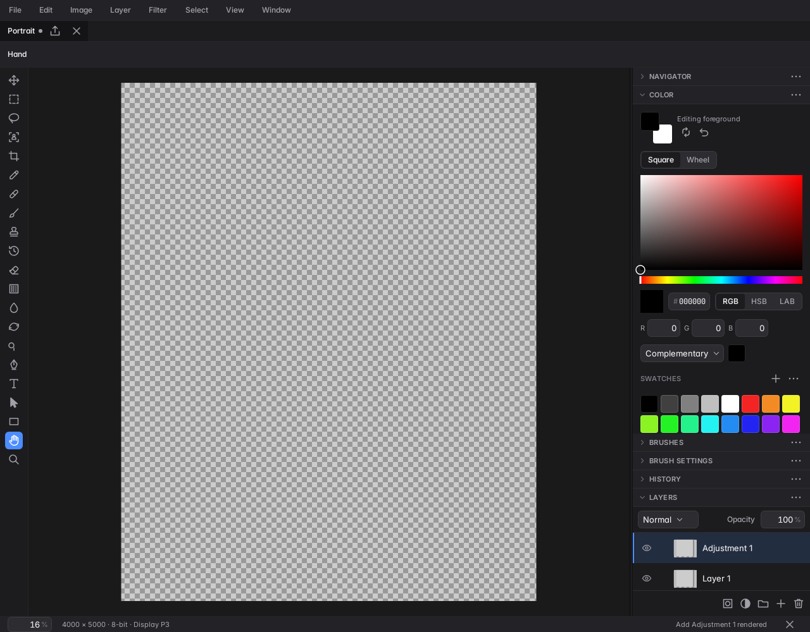
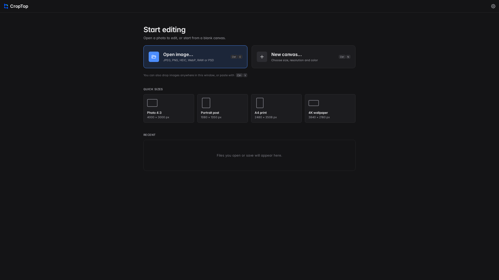

# CropTop

**A free, open-source photo editor for Android tablets, Chromebooks and phones.** CropTop brings a layered editing workspace, RAW development and on-device AI tools to Android, with support for keyboard, mouse, touch and stylus input.

CropTop is actively developed. Some tools and file-format features are still evolving; supported operations are reported by the app's engine and documented in the source.

<p align="center">
  
  
</p>

## What it does

- Edits layered documents with selections, masks, painting, retouching, text, shapes and adjustment layers.
- Develops supported camera RAW files and exports common image formats. Import and export support varies by format; see the app and engine documentation for current coverage.
- Provides on-device tools for subject selection, background and object removal, denoising and upscaling. Models are downloaded when needed; they are not bundled in the Git repository.
- Adapts its workspace to large and small windows, with keyboard shortcuts and pointer, touch and stylus input.
- Includes an optional local MCP interface for AI clients to inspect and edit the open document. It is off until enabled in Settings.

## Build and run

Install JDK 21 and Android SDK Platform 37. The full native build also needs Android NDK `27.1.12297006` and CMake as configured by the project. Accept the Android SDK licenses and connect an Android device or start an emulator.

```sh
# Build and install the complete app, including the native engine.
./gradlew :app:installFullDebug

# Faster emulator build for one ABI.
./gradlew :app:installFullDebug -Pcroptop.abi=x86_64

# Build the UI with the in-memory fake engine (no native engine build).
./gradlew :app:installFakeDebug
```

The `full` flavor uses the C++ engine. The `fake` flavor uses a Kotlin in-memory engine for UI development and tests; it is not a substitute for checking native editing behavior.

## Test

```sh
# JVM and Robolectric tests across modules.
./gradlew testDebugUnitTest :app:testFakeDebugUnitTest :app:testFullDebugUnitTest

# Android instrumentation tests on a connected device or emulator.
./gradlew connectedDebugAndroidTest
```

Native engine tests and sanitizers have separate CMake targets under [`core/engine/src/main/cpp`](core/engine/src/main/cpp). See [Contributing](CONTRIBUTING.md) for guidance on choosing checks for a change.

## Project structure

| Path | Responsibility |
| --- | --- |
| `app/` | Android application, navigation, dependency injection and build flavors |
| `feature/` | Home, editor, RAW develop, photo library, export and settings screens |
| `core/engine-api/` | Kotlin document and editing contract used by the app |
| `core/engine/` | Native C++ image engine, JNI bridge, codecs and rendering |
| `core/engine-fake/` | In-memory engine used for fast UI development and tests |
| `core/designsystem/` | CropTop colors, typography, icons and reusable Compose controls |
| `core/ai/` | On-device model runtime, downloads and AI editing operations |
| `core/data/` | Local persistence and repositories |
| `core/input/` | Keyboard, pointer, touch and stylus input routing |
| `core/agent/` | Optional local MCP server and document tools |
| `build-logic/` | Shared Gradle convention plugins |
| `docs/` | Architecture, product policies and device evidence |

For module dependencies and document flows, see [Architecture](docs/architecture.md).

## Project documents

- [Architecture](docs/architecture.md)
- [Contributing](CONTRIBUTING.md)
- [Third-party notices](core/engine/THIRD_PARTY.md) and the in-app **Settings → Open-source licenses** screen
- [Trademark policy](TRADEMARKS.md)

## License

CropTop is licensed under the [GNU General Public License v3.0 or later](LICENSE). Third-party libraries and downloaded model weights may have separate terms; review the notices shipped with the project and each model before redistributing it. The CropTop name, logo and app icon are project trademarks; see [TRADEMARKS.md](TRADEMARKS.md).
