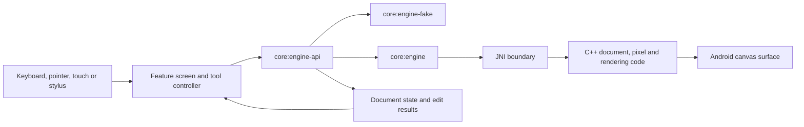

# Architecture

This note describes how the current source tree is organized. It is a guide to the implementation, not a feature roadmap. Public interfaces and build configuration are the source of truth when details change.

## Module map

```text
app/                         Android entry point, navigation and dependency wiring
feature/                     Home, editor, develop, library, export and settings UI
core/
  model/                     Shared document and editing models
  engine-api/                Kotlin interface between UI and document engines
  engine-fake/                In-memory implementation for UI development and tests
  engine/                     C++ engine, JNI bindings, codecs and rendering
  designsystem/               Theme, tokens, icons and reusable Compose components
  input/                      Keyboard, pointer, touch and stylus input abstractions
  data/                       Persistence and repository implementations
  ai/                         On-device models and editing operations
  cloud/                      Reserved foundation module; no implementation yet
  agent/                      Optional local MCP server and document tools
  io/, color/, raw/            File IO, color management and RAW processing
build-logic/                  Shared Gradle plugins and Android build conventions
benchmark/                    Startup and performance benchmarks
baselineprofile/               Baseline profile generation
```

The app module is the composition root. It selects an engine implementation by build flavor and supplies shared dependencies to feature modules. Feature modules depend on the Kotlin engine contract and shared core modules; UI code should not call JNI directly.

## Editing and rendering path



The `fake` product flavor wires the Kotlin in-memory engine for fast UI iteration. The `full` flavor wires the native engine. A successful fake-flavor test checks UI contracts; native file, rendering and performance behavior needs native or connected-device evidence as appropriate.

Editing operations return explicit results through the engine API. Document state is exposed to the UI as observable snapshots. Native pixel work and file operations live behind the engine boundary, allowing the fake implementation to exercise UI state without loading the C++ engine.

## Native engine

`core/engine` contains the C++ implementation and JNI bridge, built with CMake and the Android NDK. Kotlin declarations for engine features live in `core/engine-api`; the fake engine is expected to implement the same supported contract. When a contract changes, update the API and both implementations together, and keep the contract version in `Engine.kt` aligned.

The engine tree contains document/layer operations, tiled pixel storage, selections and masks, filters, RAW support, color management, codecs, and rendering code. Not every operation is supported by every format or device. Check API capability and operation results rather than assuming all formats have identical behavior.

## Persistence and AI

`core/data` owns local repositories and persistence used by the app. `core/ai` manages optional on-device models and editing operations. Model weights are fetched at runtime rather than committed to this repository. Their identifiers, sources, checksums and license notes are recorded in [`core/ai/MODELS.md`](../core/ai/MODELS.md); each model has its own terms.

The local MCP server is a separate opt-in integration in `core/agent`. It exposes selected document operations to a local client and uses the engine API for edits. `core/cloud` is an empty foundation module at present; cloud AI is not implemented in this repository.

CropTop's editable project format is `.croptop`; it preserves the document structure and supported editing data. Raster files and other layered formats are handled through the IO/engine paths and may not retain every source format feature. Treat import/export support as format-specific.

## Design system

`core/designsystem` provides the shared visual foundation for feature modules: semantic color and typography tokens, sizing, icons, input controls, dialogs, menus, panels and feedback components. Feature screens compose these components and should use the shared tokens so visual and accessibility fixes carry across the app.

Component tests and screenshots live beside the design-system module. Editor and home screenshots are in their respective feature test trees. Use those fixtures as regression evidence; they are not a substitute for checking the app on target window sizes, input devices and native engine builds.

## Build variants and checks

- `full` builds and packages the native engine for the configured Android ABI or ABIs.
- `fake` builds the app with the in-memory engine to support faster UI work.
- JVM/Robolectric tests cover Kotlin logic and Compose behavior.
- Android instrumentation tests cover behavior that requires the Android runtime or a connected device.
- CMake native tests, sanitizer builds and benchmarks cover C++ engine behavior separately.

See the root [README](../README.md) for common build commands and [CONTRIBUTING](../CONTRIBUTING.md) for the change workflow.
